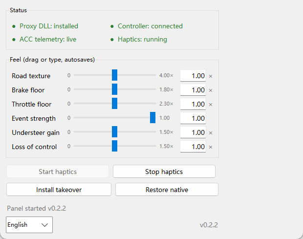
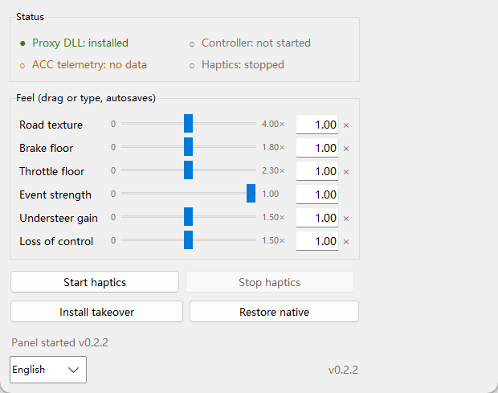

# ACC Trigger Haptics

English | [简体中文](README.zh-CN.md)

> Unofficial personal project. Not affiliated with Kunos Simulazioni or 505 Games.
> This project uses AI-generated content (code, documentation and tuning). It may contain
> errors; read the [disclaimer](#disclaimer) before use.

Adds Xbox controller **trigger haptics** to Assetto Corsa Competizione (ACC).
ACC only rumbles the two grips; this program reads the game's telemetry and uses all four
motors: grips for road feel, triggers for braking, throttle and tyre limits.

**Current version: v0.2.2** · [Download the latest release](https://github.com/T51hway/acc-trigger-haptics/releases/latest) · about 10 MB, single file, no Python required.



*UI illustration: all four lamps green, sliders at their defaults. In real use the ACC telemetry lamp stays amber until you are on track.*

---

## Safety

The program is not code-signed, so Windows may warn that the publisher is unknown. That is expected.

- exe SHA256: `863b97255c9a5eb656f0ecfa6436c60315a6c6e4b018859c6b3edf50fe62cadb`
- Proxy DLL SHA256: `8e284775850c9cba345b2b9912a71a45050f84c9186a0387387f5105cd4afe6c`
- Multi-engine scan (VirScan, 30 engines): [v0.2.0 exe](https://www.virscan.org/report/4e4482472f3b62f87246e50194903a372bc64e93bd57e0fdf6c3069cb45a6cd0) · [proxy DLL](https://www.virscan.org/report/8e284775850c9cba345b2b9912a71a45050f84c9186a0387387f5105cd4afe6c). The v0.2.2 exe has not been rescanned yet.
- The proxy DLL is ~60 lines of C: [`proxy.c`](tools/xinput_proxy/proxy.c); build command in the README next to it
- After downloading, double-click `校验哈希.bat` ("verify hash"): it compares the fingerprint above and tells you whether it matches (the exe only for a release-only download; the proxy DLL too when running from source)

If you can reach VirusTotal, you can upload the same file yourself and compare it with the SHA256 above.

---

## What it gives you, what it takes away

**It gives you:**

| Channel | Feedback |
| --- | --- |
| Left trigger | Brake pressure; a short "tick-tick" when a front wheel locks or ABS kicks in |
| Right trigger | Throttle pressure; rear wheelspin; understeer (front slipping more than rear) |
| Left grip | Left-side road texture; rear slide / loss of control |
| Right grip | Right-side road texture; rear slide / loss of control |

**It takes away:**

After you install the takeover, **ACC's own controller rumble is blocked completely**;
all four motors are driven by this program. The grip feel is this program's own mix,
not ACC's native rumble. If you prefer the native grip feel, click **Restore native** —
but **trigger haptics stop working too**, because ACC starts overwriting the triggers every frame again.

The grip feel has only been tested on the author's controller. Different controllers and
different hands will feel different; start with the defaults and tune from there.

A steering wheel / base is unaffected: it uses DirectInput force feedback, a separate channel
from controller rumble.

---

## 3-minute setup

### Before you start

- Windows 10 / 11
- Controller: Xbox Series X|S (tested). Xbox 360 has no trigger motors; other Xbox controllers
  (One / One S / Elite 2) are untested and not guaranteed to work.
- Turn off **Steam Input** in Steam:
  Steam → Settings → Controller → Enable Steam Input for Xbox controllers (off).
  If Steam's controller settings also show `Xbox Controller Enhanced Features Driver`, turn it off too.
- ACC PC (Steam); console versions are out of scope.
  **Quit ACC completely** (not minimized) before installing the takeover.

### Steps

1. Download `ACC-Trigger-Haptics.exe` from
   [Releases](https://github.com/T51hway/acc-trigger-haptics/releases/latest).
2. Put it in a **normal folder**, for example `D:\ACC-Trigger-Haptics\`.
   Do not put it in `C:\Program Files`, and do not run it straight from the zip —
   the program writes its settings and log next to itself.
3. Double-click it. The first run may show Windows SmartScreen:
   click **More info** → **Run anyway**.
4. Click **Install takeover**. It copies a small proxy DLL into the ACC folder
   that does one thing: stops ACC from zeroing the controller rumble every frame.
   **It takes effect the next time ACC starts**; if ACC is running, the panel asks you to quit it first.
5. Start ACC and get on track (not the main menu).
6. Back in the panel, click **Start haptics**.
7. Four green lamps = Proxy DLL / Controller / ACC telemetry / Haptics all working.
8. Drag the sliders to tune; changes apply within a second, no game restart needed.

While running, Start haptics is greyed out; use Stop haptics. The language switch is at the
bottom left; the version number is at the bottom right. If ACC is in fullscreen, Alt+Tab back
to the panel; borderless mode is more convenient for tuning.

> You can minimize the panel, but **do not close it**. Closing stops the haptics and zeroes
> the motors first; killing it from Task Manager may leave the motors running.
> There is no tray icon and no auto-start.

---

## What the takeover actually changes

It adds one file:

```
...\Assetto Corsa Competizione\AC2\Binaries\Win64\xinput1_3.dll
```

- No existing files are changed, no driver is installed, no registry keys are written
- Controller reads are forwarded unchanged to the system `xinput1_3.dll`; input is unaffected
- Only `XInputSetState` (the call ACC uses to write rumble) is intercepted and returns success without forwarding
- Delete or rename the file to restore everything; **Restore native** renames it to `xinput1_3.dll.off`

For the full explanation (including how to compile it yourself), see
[`tools/xinput_proxy/README.md`](tools/xinput_proxy/README.md).

**Steam file verification may report one unexpected file**: that is the added DLL, which is expected.
If you care, click **Restore native**, delete `xinput1_3.dll.off`, then verify.

### Manual install / restore

If the panel is broken or cannot find ACC:

- Install (when running from source): copy `tools\xinput_proxy\xinput1_3.dll`
  into the `Win64` folder above
- Restore: rename `xinput1_3.dll` to `xinput1_3.dll.off`, or delete it

### Uninstall order (important)

1. Click **Restore native** in the panel
2. Close the panel
3. Delete the exe, `手感设置.toml`, `panel.log`, `panel-settings.json`
4. If `xinput1_3.dll.off` is still in the `Win64` folder, delete it too

**Do not** just delete the exe. If the proxy DLL stays in the game folder, ACC thinks rumble
is still taken over, so neither the grips nor the triggers rumble — and nothing tells you why.

---

## Compatibility

| Item | Status |
| --- | --- |
| Windows | 10 / 11 |
| Xbox Series X\|S | ✅ Bluetooth / USB-C; tested |
| Other Xbox controllers (One / One S / Elite 2) | ⚠️ Untested; they have trigger motors, but are not guaranteed to work |
| Xbox 360 controller | ❌ No trigger motors |
| Third-party "Xbox-compatible" controllers (8BitDo, Flydigi, BETOP, etc.) | ⚠️ Untested. Many have no trigger motors, or do not use Microsoft's HID report, so they may not respond at all |
| Official Xbox Wireless Adapter | ⚠️ Untested |
| Wheel + controller connected at the same time | Only the Xbox controller is driven; the wheel is unaffected. Multiple controllers are not explicitly handled |
| ACC platform | PC (Steam); console versions are out of scope |
| ACC version | v0.2.0 tested on the 2026-11 ACC build; if rumble becomes intermittent after a big game update, reinstall the takeover |

---

## Troubleshooting

Check the four lamps first:



*Real first-launch state (the takeover is installed in this example): haptics not started, no ACC telemetry yet.*

| Lamp | Green means | If it is not green |
| --- | --- | --- |
| Proxy DLL | Installed | Click **Install takeover**; quit ACC completely first |
| Controller | Connected (only after Start haptics; amber "waiting" if not connected) | Click Start haptics first; if it stays amber, press a button, check Bluetooth pairing, and make sure Steam Input is off |
| ACC telemetry | Live | You must be on track; no data in the main menu / while paused is normal |
| Haptics | Running | Click **Start haptics** |

**All four green, but the triggers do not vibrate**

- Is Steam Input on again?
- Did you turn vibration off in the controller firmware / Xbox Accessories?
- Is the USB cable charge-only? Try a data cable.
- At very low battery the trigger motors may not run; replace the battery or plug in.
- Did an ACC update overwrite the proxy DLL? Reinstall the takeover.

**Install takeover says "File missing" / antivirus removed the DLL (some AVs flag it)**

Add the exe and the ACC `Win64` folder to your antivirus exclusions, then click Install takeover again.
Only do this if you trust the source.

**It worked before, but became stuttery after an ACC update**

Reinstall the takeover (the update may have replaced `xinput1_3.dll`). Quit ACC completely first.

**The telemetry lamp is off**

ACC must be on track; there is no data in the main menu or while paused.
If ACC runs as administrator, run the panel as administrator too.

**"A motor driver is already running"**

You have two panels / two rumble programs open. Close the other one; two writers fight
over the controller.

**Using it with SimHub, DSX, etc.**

They may also write to the same controller motors; the result is messy, intermittent or
fighting rumble. Run only one controller-rumble tool at a time.

**Getting ACC's native rumble back**

Click **Restore native**. Note that trigger haptics stop working too, because ACC starts
zeroing the triggers every frame again. The wheel is unaffected.

**Still not working**

Send `panel.log` (next to the exe) to
[Issues](https://github.com/T51hway/acc-trigger-haptics/issues),
along with: ACC version, controller model, Bluetooth or wired, and Windows version.
The log contains only runtime status and local paths, no account credentials.

---

## Tuning

Six sliders in the panel; drag them or type a value, and changes are saved automatically:

| Slider | What it does | Default | Suggested range |
| --- | --- | --- | --- |
| Road texture | Grip rumble from the road surface | 1.00 | 0 – 4 |
| Brake floor | Left trigger follows brake pressure | 1.00 | 0 – 1.8 |
| Throttle floor | Right trigger follows throttle | 1.00 | 0 – 2.3 |
| Event strength | Pulse strength for lock / ABS / wheelspin | 0.75 | 0 – 1.0 |
| Understeer gain | Right trigger strength when the front pushes; 0 = off | 1.00 | 0 – 1.5 |
| Loss of control | Both grips when the rear slides / spins; 0 = off | 1.00 | 0 – 1.5 |

Road texture, brake floor, throttle floor, understeer gain and loss of control are
**multipliers**: `1.00` is the standard feel, `0` turns the channel off. On these five
sliders `1.00` sits in the middle: the left half goes `0 → 1.00`, the right half
`1.00 → the maximum` shown at the end.

The value box on the right accepts direct input: press Enter or click away to apply,
Esc to cancel. Values above the maximum are clamped and reported.
Above about `1.25` on the brake floor, lock / ABS contrast gets weaker — more is not better.

**How to tune:**

- Road too noisy / grips always buzzing: lower **Road texture**
- Triggers feel dead: raise **Brake floor** / **Throttle floor**, but keep the brake
  floor below about 1.25×, otherwise the lock / ABS contrast gets weaker
- Lock / ABS not obvious enough: raise **Event strength**
- Understeer false alarms: lower **Understeer gain** or set it to 0 (off)
- Loss-of-control false alarms in normal corners: lower **Loss of control** or set it to 0

**Editing the file directly:**

`手感设置.toml` (Chinese for "feel settings") sits next to the exe.
**A fresh install does not create this file automatically**; drag any slider once and it appears.
Only change the numbers on the right-hand side of `=`; everything after `#` is a comment.
Save the file and it applies within a second.

**Restoring defaults:** quit the program, delete `手感设置.toml`, and start it again;
or drag all six sliders back to the defaults above.

---

## 2-minute self-check

No full lap needed. Do this once to confirm every channel:

1. **Lock**: set ABS to its lowest setting or off, brake hard in a straight line until the front locks → short ticks on the left trigger
2. **ABS**: set ABS high, brake hard → intermittent ticks on the left trigger
   (with high ABS the wheels rarely lock; that is normal)
3. **Rear wheelspin**: low-speed, full throttle out of a corner → right trigger rumbles; less when TC intervenes
4. **Understeer**: brake late and add steering → the right trigger rumbles continuously
5. **Loss of control**: lower or turn off TC, full throttle out of a corner until the rear slides → both grips rumble together
6. **Road feel**: drive normally for a bit → both grips give a continuous road texture

---

## What it does not do / known limitations

- Reads ACC's shared-memory telemetry only (like SimHub); it does not write to game memory
  and does not change vehicle physics
- Off-track driving without wheel slip is not reported; the cue is driven by slip angle, not surface type
- Low-speed spins fade out below about 14 km/h, so parking-lot manoeuvres stay quiet
- Four-wheel lock is left to the left-trigger lock pulse, not duplicated on the grips
- Understeer / loss of control are heuristic; extreme situations may false-positive or miss.
  The thresholds live in code and are not all exposed
- The grip rumble is this program's own mix, **with no native fallback**; if you dislike it,
  **Restore native**, but then the triggers stop working
- Long sessions and Bluetooth reconnects have not been endurance-tested
- The official wireless adapter, Elite 2 and third-party controllers are untested
- Trigger motors use more battery; Bluetooth battery life will be shorter
- No tray icon, no auto-start; the panel must stay open (minimizing is fine)

**Multiplayer / leagues:** it does not modify vehicle data and does not read data the game
does not expose; it is essentially a tactile display. But it adds a DLL to the game folder,
and some leagues / platforms have rules about modifying game files. Check your rules before
racing. This project is not responsible for bans or league penalties.

---

## Disclaimer

This is an unofficial personal project. It is not affiliated with, endorsed by, or authorized
by Kunos Simulazioni, 505 Games, or Microsoft / Xbox.

The project is provided "as is", without warranty of any kind, express or implied.
**To the maximum extent permitted by applicable law**, the author is not liable for any direct
or indirect damage arising from the use or inability to use this project, including but not
limited to controller motor wear or other hardware damage, battery wear, corrupted game files,
lost saves or data, account bans, league penalties, or problems caused by ACC updates, drivers,
Bluetooth connections, or conflicts with third-party software.

This project contains AI-generated content and may contain errors. Installing the takeover adds
a proxy DLL to the ACC folder; this may trigger Steam file verification warnings, antivirus
false positives, or violate league/platform rules about modifying game files. Check and follow
the applicable rules before use. Please only use it with a legitimate copy of ACC.

**Nothing in this notice excludes or limits any liability that cannot be excluded or limited
by law**, including liability for intentional misconduct or gross negligence, or for personal
injury where such liability cannot be waived. If you do not accept these terms, do not use the
project. The code is released under the MIT License; this notice does not replace the terms in `LICENSE`.

---

## Run from source / build (optional)

Requires Python 3.11+ with a full **tkinter** build (not the Microsoft Store placeholder).

```
python src/main.py      # console version
python src/panel.py     # graphical panel
```

Build (Windows, PyInstaller):

```
python -m pip install pyinstaller
python -m PyInstaller --noconfirm --clean --onefile --windowed --name ACC-Trigger-Haptics --paths src --add-data "tools\xinput_proxy\xinput1_3.dll;tools\xinput_proxy" src\panel.py
```

The output is `dist\ACC-Trigger-Haptics.exe`, ready to upload to a release. When running from source,
`开启接管.bat` / `恢复原生.bat` do the same install/restore job. Note that these scripts
only check a few common Steam library paths; if the game is installed elsewhere, add your
path to the script. If unsure, use the panel's **Install takeover**, which reads the Steam registry.

---

## License

MIT, see `LICENSE`.

The rear-slide (loss-of-control) and understeer detection logic is adapted from
[ACC DualSense Feedback](https://github.com/Adudumax/ACC-DualSense-Feedback) (MIT).
Only the detection approach was adapted; the Xbox HID motor driver is this project's own.
