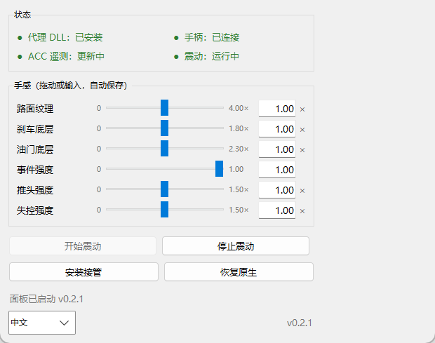
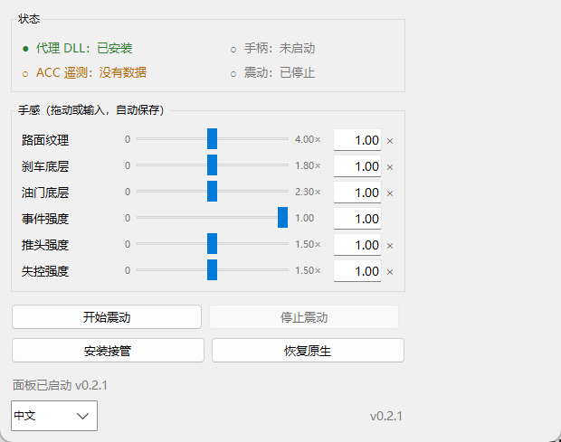

# ACC Trigger Haptics

[English](README.md) | 简体中文

> 非官方个人项目，与 Kunos Simulazioni / 505 Games 无关。
> 本项目使用 AI 生成内容（代码、文档和调参建议），可能存在错误；使用前请阅读文末的[免责声明](#免责声明)。

给《神力科莎：竞技版》（ACC）补上 Xbox 手柄的**扳机震动**。ACC 原生只震两个握把；
这个程序读游戏遥测，把四个马达都用起来：握把给路感，扳机给刹车、油门和轮胎极限。

**当前版本 v0.2.1** · [下载最新版](https://github.com/T51hway/acc-trigger-haptics/releases/latest) · 约 10 MB，单文件，不需要安装 Python。



*界面示意：四盏灯全绿、滑块在默认值时的面板。实际未进游戏时，ACC 遥测灯是黄的。*

---

## 安全性

程序没有数字签名，Windows 可能提示「未知发布者」，这是正常的。

- exe 指纹（SHA256）：`f780adeb1e3cb5f5b9c55c3d398697734e1724d410c5ae993bee6296a685a4fa`
- 代理 DLL 指纹（SHA256）：`8e284775850c9cba345b2b9912a71a45050f84c9186a0387387f5105cd4afe6c`
- 多引擎扫描结果（VirScan，30 个引擎）：[v0.2.0 的 exe](https://www.virscan.org/report/4e4482472f3b62f87246e50194903a372bc64e93bd57e0fdf6c3069cb45a6cd0) · [代理 DLL](https://www.virscan.org/report/8e284775850c9cba345b2b9912a71a45050f84c9186a0387387f5105cd4afe6c)。v0.2.1 的 exe 尚未重新扫描。
- 代理 DLL 只有 60 行 C 源码：[`proxy.c`](tools/xinput_proxy/proxy.c)，编译命令在同目录的 README
- 下载后双击 `校验哈希.bat`，它会比对上面的指纹并告诉你是否一致（只下载 exe 时校验 exe；从源码使用时会连代理 DLL 一起校验）

如果能访问 VirusTotal，也可以自己上传同一个文件，和上面的指纹对照。

---

## 它会给你什么，会拿走什么

**给你：**

| 通道 | 反馈 |
| --- | --- |
| 左扳机 | 刹车踩多深；前轮抱死 / ABS 介入时的急促「嗒嗒」 |
| 右扳机 | 油门踩多深；后轮打滑；推头（前轮比后轮多滑） |
| 左握把 | 左侧路面纹理；车尾横滑 / 失控 |
| 右握把 | 右侧路面纹理；车尾横滑 / 失控 |

**拿走：**

装「接管」后，**ACC 自己的手柄震动会被完全屏蔽**，四个马达都由这个程序驱动。
握把的路感是这个程序自己算的，不是 ACC 原生那套；如果你更喜欢原生握把震动，
点「恢复原生」即可，但**扳机震动也会一起失效**——ACC 会重新每帧把扳机清零。

握把的手感目前只在作者的手柄上验证过。不同手柄、不同人的感受会不一样，
建议先用默认值，再按自己的感觉微调。

方向盘 / 基座不受影响：它走 DirectInput 力反馈，和手柄震动是两套独立通道。

---

## 3 分钟上手

### 前提

- Windows 10 / 11
- 手柄：Xbox Series X|S（已实测）。Xbox 360 没有扳机马达；其它 Xbox 手柄（One / One S / Elite 2）未测试，不保证可用。
- 在 Steam 里关掉 **Steam 输入**：
  Steam → 设置 → 控制器 → 为 Xbox 控制器启用 Steam 输入（关）。
  Steam 的控制器设置里如果还有 `Xbox Controller Enhanced Features Driver`，也建议一起关。
- ACC PC 版（Steam）；主机版不适用。安装接管时要**完全退出** ACC（不是最小化）

### 步骤

1. 从 [Releases](https://github.com/T51hway/acc-trigger-haptics/releases/latest) 下载
   `ACC-Trigger-Haptics.exe`。
2. 把它放进一个**普通文件夹**，比如 `D:\ACC-Trigger-Haptics\`。
   不要放 `C:\Program Files`，也不要每次从压缩包里直接双击——
   程序要在自己旁边写设置和日志。
3. 双击运行。第一次可能遇到 Windows SmartScreen：
   点「更多信息」→「仍要运行」。
4. 点 **「安装接管」**。它会往 ACC 目录放一个小代理 DLL，只做一件事：
   不让 ACC 每帧把手柄震动清零。**装完要下次启动 ACC 才生效**；
   ACC 正在运行时会提示你先退出。
5. 启动 ACC，进入赛道（不要停在主菜单）。
6. 回到面板，点 **「开始震动」**。
7. 四盏灯全绿 = 代理 DLL / 手柄 / ACC 遥测 / 震动 都在工作。
8. 拖动滑块调手感，1 秒内生效，不用重启游戏。

运行中「开始震动」会变灰，点「停止震动」可停。左下角可以切换 English / 中文，右下角显示版本号。
ACC 用全屏时，Alt+Tab 切回面板；无边框窗口模式更方便调手感。

> 面板可以最小化，但**不要关**。关窗口会先停止震动并清零马达；
> 用任务管理器强杀可能留下马达在震。程序没有托盘图标，也没有开机自启。

---

## 安装到底改了什么

只新增一个文件：

```
...\Assetto Corsa Competizione\AC2\Binaries\Win64\xinput1_3.dll
```

- 不改任何原有文件，不装驱动，不写注册表
- 读手柄的调用原样转发给系统的 `xinput1_3.dll`，输入完全不受影响
- 只拦截 `XInputSetState`（ACC 用来写震动的那一个调用），直接返回成功，不往下传
- 删掉或改名就完全恢复；「恢复原生」就是把它改名成 `xinput1_3.dll.off`

更细的说明（含自己编译的方法）见
[`tools/xinput_proxy/README.md`](tools/xinput_proxy/README.md)。

**Steam 校验文件可能报 1 个文件异常**：这是新增的 DLL，属正常现象。
介意的话，先点「恢复原生」，再删掉 `xinput1_3.dll.off`，然后校验。

### 手动安装 / 卸载

面板坏了或找不到 ACC 时，可以手动做：

- 安装（从源码运行时）：把 `tools\xinput_proxy\xinput1_3.dll`
  复制到上面的 `Win64` 目录
- 恢复：把 `xinput1_3.dll` 改名成 `xinput1_3.dll.off`，或直接删掉

### 卸载顺序（重要）

1. 面板上点 **「恢复原生」**
2. 关闭面板
3. 删除 exe、`手感设置.toml`、`panel.log`、`panel-settings.json`
4. 如果 `Win64` 目录里还留着 `xinput1_3.dll.off`，一起删掉

**不要**直接删 exe 就跑。代理 DLL 留在游戏目录里，ACC 会以为震动被接管了，
结果握把和扳机都不震，而且没人告诉你为什么。

---

## 兼容性

| 项目 | 情况 |
| --- | --- |
| Windows | 10 / 11 |
| Xbox Series X\|S | ✅ 蓝牙 / USB-C；已实测 |
| 其它 Xbox 手柄（Xbox One / One S / Elite 2） | ⚠️ 未测试；有扳机马达，但不保证可用 |
| Xbox 360 手柄 | ❌ 没有扳机马达 |
| 第三方「Xbox 兼容」手柄（北通 / 飞智 / 八位堂等） | ⚠️ 未测试。很多没有扳机马达，或不用微软的 HID 报文，可能完全没反应 |
| 官方 Xbox 无线适配器 | ⚠️ 未测试 |
| 同时接方向盘 + 手柄 | 程序只驱动 Xbox 手柄；方向盘不受影响。多手柄时选哪个没有专门处理 |
| ACC 平台 | PC Steam 版；主机版不适用 |
| ACC 版本 | v0.2.0 在 2026-11 的 ACC 版本上测试；游戏大更新后如果震动变断续，先重装接管 |

---

## 排障

先看四盏灯：



*真实启动、还没开始震动时的状态（示例中代理 DLL 已装）：手柄未启动、ACC 遥测没有数据。*

| 灯 | 绿色代表 | 不绿怎么办 |
| --- | --- | --- |
| 代理 DLL | 已安装 | 点「安装接管」；ACC 要先完全退出 |
| 手柄 | 已连接（点「开始震动」后才会亮；没连上时是黄的「等待连接」） | 先点「开始震动」；如果还是黄的，按一下手柄、检查蓝牙配对、确认 Steam 输入已关 |
| ACC 遥测 | 正在更新 | 必须进入赛道；主菜单 / 暂停时没有数据是正常的 |
| 震动 | 正在运行 | 点「开始震动」 |

**四盏灯全绿，但扳机不震**

- Steam 输入是不是又开了？
- 手柄固件 / Xbox Accessories 里是不是把震动关了？
- USB 线是不是只能充电？换一根数据线。
- 电池电量太低时，扳机马达可能不工作；换电池或插线试试。
- 代理 DLL 是不是被 ACC 更新覆盖了？重装接管。

**安装接管提示「文件缺失」/ 杀软把 DLL 删了（部分杀软会误报）**

把 exe 和 ACC 的 `Win64` 目录加入杀软白名单，再点一次「安装接管」。
只在确认文件来源可信时这样做。

**以前能用，ACC 更新后变断续**

重装接管（更新可能把 `xinput1_3.dll` 覆盖掉）。装之前先完全退出 ACC。

**遥测灯不亮**

ACC 要进赛道；主菜单、暂停时都没有数据。
如果 ACC 以管理员身份运行，面板也要用管理员身份打开。

**提示「已经有一个马达驱动在运行」**

你开了两个面板 / 两个震动程序。关掉另一个再试；两个写入者会互相打断。

**和 SimHub、DSX 等工具一起用**

它们也可能在写同一组手柄马达，冲突时表现为震动乱、断、抢。
建议同一时间只开一个手柄震动工具。

**想恢复 ACC 原生震动**

点「恢复原生」。注意：扳机震动会一起失效，因为 ACC 会重新每帧清零扳机。
方向盘不受影响。

**还是不行**

把 `panel.log`（和 exe 同目录）发到
[Issues](https://github.com/T51hway/acc-trigger-haptics/issues)，
并写上：ACC 版本、手柄型号、蓝牙还是有线、Windows 版本。
日志里只有运行状态和本地路径，不含账号密码。

---

## 调手感

面板上六个滑块，拖动或直接输入数值，自动保存：

| 滑块 | 作用 | 默认 | 建议范围 |
| --- | --- | --- | --- |
| 路面纹理 | 握把的路面粗糙感 | 1.00 | 0 ~ 4 |
| 刹车底层 | 左扳机跟着刹车深度震 | 1.00 | 0 ~ 1.8 |
| 油门底层 | 右扳机跟着油门深度震 | 1.00 | 0 ~ 2.3 |
| 事件强度 | 锁死 / ABS / 后轮打滑的脉冲强度 | 0.75 | 0 ~ 1.0 |
| 推头强度 | 推头时右扳机的强度，0 = 关掉 | 1.00 | 0 ~ 1.5 |
| 失控强度 | 车尾横滑 / 打转时两个握把的强度，0 = 关掉 | 1.00 | 0 ~ 1.5 |

路面 / 刹车 / 油门 / 推头 / 失控都是**倍率**：`1.00` 是标准手感，`0` 是关掉。
这五个滑块的 `1.00` 在正中间：左半段 `0 → 1.00`，右半段 `1.00 → 上限`；
两端标了最小值和最大值。

右侧输入框可以直接输入数字：回车或点走焦点生效，Esc 取消；超出上限会夹到上限并提示。
刹车底层超过 `1.25` 左右，锁死 / ABS 的对比会变弱——不是越大越好。

**怎么调：**

- 觉得路面太吵 / 握把一直震：先降「路面纹理」
- 觉得扳机没实感：加「刹车底层」「油门底层」，但刹车别超过 1.25×，
  否则锁死 / ABS 的对比会变弱
- 觉得锁死 / ABS 不够明显：加「事件强度」
- 觉得推头乱报：降「推头强度」或设 0（彻底关掉）
- 觉得正常过弯也在报失控：降「失控强度」或设 0

**直接改文件：**

`手感设置.toml` 和 exe 在同一层。**全新安装时这个文件不会自动出现**，
拖一下任意滑块才会生成。只改等号 `=` 右边的数字，`#` 后面是说明。
改完保存，1 秒内生效。

**恢复默认：** 退出程序，删掉 `手感设置.toml`，再启动；
或者把六个滑块拖回上表的默认值。

---

## 2 分钟自检

不用跑完整圈，按下面做一遍，能确认每条通道：

1. **锁死**：把 ABS 调到最低或关掉，直线重刹到抱死 → 左扳机急促嗒嗒
2. **ABS**：ABS 调高，重刹 → 左扳机断续嗒嗒
   （高 ABS 下几乎不会锁死，这是正常的）
3. **后轮打滑**：低速大油门出弯 → 右扳机震；TC 介入时会变少
4. **推头**：故意晚入弯、方向打多 → 右扳机持续震
5. **失控**：把 TC 调低或关掉，大油门出弯让车尾滑 → 两个握把一起震
6. **路感**：正常跑一段 → 两个握把有连续的路面纹理

---

## 它不做什么 / 已知限制

- 只读 ACC 的共享内存遥测（和 SimHub 同类），不往游戏内存里写数据，也不改车辆物理
- 冲出赛道但轮胎没打滑时不报；判据是侧滑，不是路面类型
- 约 14 km/h 以下的低速打转会淡出，避免停车挪车误报
- 四轮抱死不重复放到握把，继续只走左扳机的锁死嗒嗒
- 推头 / 失控是启发式判定，极端工况可能误报或漏报；阈值在代码里，暂未全部外放
- 握把震动是本程序自己混的，**没有原生兜底**；不满意可以「恢复原生」，但扳机就没了
- 长距离耐力、蓝牙断连重连没有专门验证
- 官方无线适配器、Elite 2、第三方手柄未测
- 扳机马达比握把更费电；蓝牙连接下续航会短一些
- 没有托盘图标、开机自启；面板要一直开着（可以最小化）

**联机 / 联赛：** 它不修改车辆数据，也不读取游戏没有提供的数据；
本质是一个触觉提示器。但它会往游戏目录放一个 DLL；
有些联赛 / 平台对「修改游戏文件」有规定，赛前请自己确认规则。
本项目不对封号或赛事判罚负责。

---

## 免责声明

本项目是非官方个人项目，与 Kunos Simulazioni、505 Games、Microsoft / Xbox 均无关联，
也未获得其授权或认可。

本项目按“现状”提供，不附带任何明示或暗示的担保。**在适用法律允许的最大范围内**，
作者不对使用或无法使用本项目造成的任何直接或间接损失负责，包括但不限于
手柄马达磨损或其他硬件损坏、电池损耗、游戏文件损坏、存档或数据丢失、账号封禁、
赛事判罚，以及因 ACC 更新、驱动、蓝牙连接或第三方软件冲突导致的问题。

本项目包含 AI 生成内容，可能存在错误或不足。安装「接管」会在 ACC 目录中新增一个代理 DLL，
可能触发 Steam 文件校验提示、杀毒软件误报，或违反某些联赛 / 平台关于修改游戏文件的规定；
请在使用前自行确认并遵守相关规则。请仅在拥有正版 ACC 的前提下使用。

**本条不排除或限制依法不能排除或限制的责任**（包括因故意或重大过失造成的责任，
以及依法不得免除的人身损害责任）。如果你不接受以上条款，请不要使用本项目。
代码以 MIT 许可证发布，本声明不替代 `LICENSE` 中的条款。

---

## 从源码运行 / 构建（可选）

需要 Python 3.11+，并且是**带 tkinter 的完整 Python**（不要用微软商店的占位版）。

```
python src/main.py      # 命令行版
python src/panel.py     # 图形面板
```

打包（Windows，PyInstaller）：

```
python -m pip install pyinstaller
python -m PyInstaller --noconfirm --clean --onefile --windowed --name ACC-Trigger-Haptics --paths src --add-data "tools\xinput_proxy\xinput1_3.dll;tools\xinput_proxy" src\panel.py
```

产物是 `dist\ACC-Trigger-Haptics.exe`，可以直接上传到 Release。源码运行时，`开启接管.bat` / `恢复原生.bat`
可以做同样的事；注意这两个脚本只认几个常见的 Steam 库路径，游戏装在别处时
要在脚本里加一行自己的路径。不确定就用面板的「安装接管」，它会读 Steam 注册表。

---

## 许可

MIT，见 `LICENSE`。

失控（后轮横滑）和推头（前轮抓地损失）的判定思路改编自
[ACC DualSense Feedback](https://github.com/Adudumax/ACC-DualSense-Feedback)（MIT）。
只借鉴判定思路，Xbox 手柄的马达驱动是本项目自己的实现。
